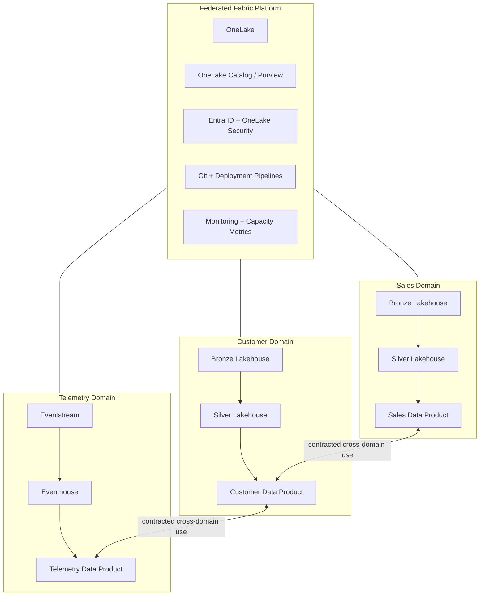
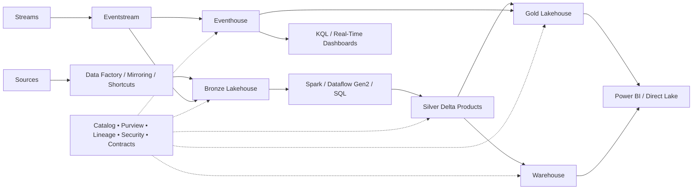
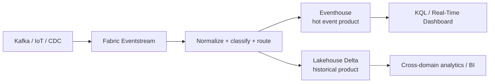
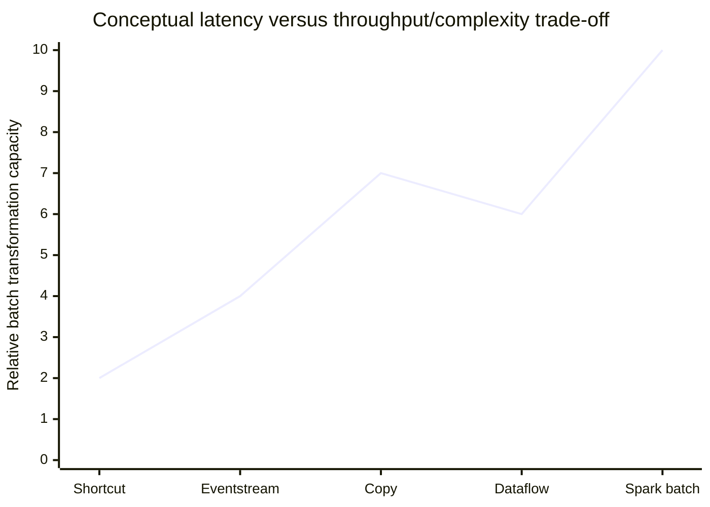
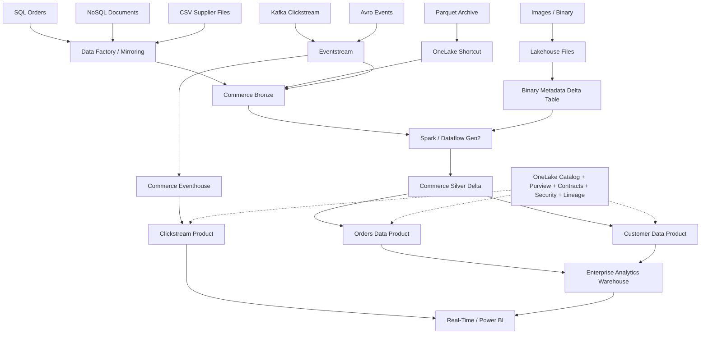

# Data Meshing Across Heterogeneous Sources and Formats with Microsoft Fabric

## Executive summary

A **data mesh** is not a storage technology, a lakehouse pattern, or a Microsoft product. It is a sociotechnical operating model for analytical data built around four principles: **domain-oriented ownership, data as a product, a self-service data platform, and federated computational governance**. In a mesh, the business domain that understands a dataset is responsible for publishing it as a reliable, discoverable, interoperable product, while a shared platform removes the infrastructure burden and common governance rules preserve interoperability across domains. citeturn791176search0turn791176academia53

Microsoft Fabric is unusually well suited to implement the *platform* side of this model because Data Factory, Data Engineering/Spark, Warehouse, Real-Time Intelligence, Power BI, governance, and security operate around **OneLake**, Fabric's organization-wide logical data lake. OneLake is built on ADLS Gen2 and provides a common storage and namespace layer, while workloads can use Spark, T-SQL, KQL, Power Query, and semantic models over the same broader data estate. Shortcuts can virtualize data that remains in other OneLake locations and supported external stores instead of requiring another physical copy. citeturn791176search1turn791176search15turn791176search3

The architectural implication is important: **a Fabric data mesh should not become one enormous centralized lakehouse**. A stronger design is to use workspaces and data products as domain boundaries, give domains autonomy over ingestion and transformation, standardize how products are documented and secured, and use OneLake, the OneLake catalog, Microsoft Purview, shared CI/CD patterns, security policy, and platform observability as the federating substrate. The recommended medallion implementation in Fabric separates raw, enriched, and curated layers, and Microsoft explicitly recommends separate lakehouses or warehouses for layers where stronger governance isolation is useful. citeturn816797search3turn367375search1

For heterogeneous ingestion, there should not be a single mandated tool. The decision should be driven by **movement semantics and latency**:

| Requirement | Preferred Fabric pattern | Why |
|---|---|---|
| Scheduled bulk relational/file ingestion | Data Factory pipeline, Copy activity, or Copy job | High-throughput movement, broad connector coverage, orchestration |
| Low-code cleansing and business transformations | Dataflow Gen2 | Power Query authoring and governed destinations |
| Complex JSON, Avro, ORC, Parquet, custom parsing, ML preprocessing | Spark notebook / Spark job + Lakehouse | Programmatic control and distributed processing |
| Data already in accessible object storage | OneLake shortcut | Avoids unnecessary duplication |
| Replication from supported operational databases | Mirroring | Keeps an analytics-oriented representation synchronized |
| Event/telemetry/CDC streams | Eventstream → Eventhouse and/or Lakehouse | Streaming transformations and near-real-time analytics |
| SQL-centric dimensional product | Warehouse | Strong T-SQL and relational modeling experience |
| High-volume event/time-series product | Eventhouse | KQL-optimized event analytics |

These options coexist rather than replace one another. Fabric explicitly exposes shortcuts, mirroring, pipelines, Copy jobs, Eventstreams, Dataflows, notebooks, Lakehouses, Warehouses and Real-Time Intelligence as complementary ingestion and processing approaches. citeturn328918search36turn791176search27turn345560search2

For heterogeneous file formats, the safest long-term strategy is **preserve first, normalize later**. Raw CSV, JSON, Avro, ORC, Parquet, images and arbitrary binary objects can remain in the bronze/file layer when preservation or reprocessing matters; analytical records should normally converge toward governed Delta tables in silver/gold. Fabric Lakehouses are optimized around Delta, while Spark can work with CSV, JSON, Parquet, ORC and Avro, and lakehouse files can hold images and other file types. citeturn328918search7turn328918search1turn328918search22

The biggest implementation risks are not connector availability but **semantic incompatibility, uncontrolled schema evolution, weak product contracts, duplicated copies, poor lineage, and shared-capacity contention**. Delta schema enforcement should therefore be the default, with explicitly governed evolution; Dataflow Gen2's dynamic schema behavior should be used selectively; product schemas and SLOs should be versioned like APIs; lineage should be validated rather than assumed complete; and Fabric Capacity Metrics should be used to understand contention between Spark, Warehouse, pipelines and BI workloads sharing capacity. citeturn345560search0turn328918search0turn345560search6turn367375search5turn367375search6

## Data mesh principles translated into Fabric

### What a data mesh actually changes

The original data-mesh formulation identifies four mutually reinforcing principles: decentralized domain ownership, data as a product, self-service infrastructure, and federated computational governance. A mesh therefore changes **organizational responsibility as much as technical topology**. Central platform teams stop becoming the mandatory implementation bottleneck for every new dataset; domain teams become accountable for analytical interfaces originating from their domains. citeturn791176search0turn791176search40

“Data as a product” means more than publishing tables. A useful data product needs an owner, documented meaning, addressable interfaces, discoverability, security, interoperability and trustworthiness. The original data-mesh model explicitly describes qualities such as discoverability, addressability, trustworthiness, self-description, interoperability and security. citeturn791176search0turn791176search9

Fabric maps naturally onto these principles, but the mapping should remain conceptual rather than product-driven:

| Data-mesh principle | Fabric implementation interpretation | Anti-pattern |
|---|---|---|
| Domain ownership | Workspace/lakehouse/warehouse/eventhouse aligned to a bounded business domain; domain team owns pipelines and data-product SLAs | Central engineering team owns every pipeline |
| Data as a product | Curated Delta/Warehouse/Eventhouse data plus semantic definition, ownership, contract, quality SLO and documentation | “Here is a table; figure out what it means” |
| Self-service platform | Reusable workspace templates, Fabric Data Factory, OneLake, notebooks, Dataflows, CI/CD, monitoring, standard security patterns | Every domain invents its own infrastructure |
| Federated governance | Enterprise policies for identity, naming, sensitivity, contracts and interoperability; domain-specific rules maintained locally | Either unrestricted decentralization or total central control |

Fabric's workspaces divide OneLake into collaboration and security boundaries; workspace roles provide Admin, Member, Contributor and Viewer permissions, while item and OneLake security can further narrow access. citeturn367375search1turn367375search4

A useful Fabric mesh therefore has **two simultaneous axes**:

1. **Domain axis** — Sales, Customer, Supply Chain, Finance, Risk, IoT, etc.
2. **quality/lifecycle axis** — raw/bronze → standardized/silver → product/gold.

Microsoft's Fabric medallion guidance describes bronze as raw, silver as enriched, and gold as curated, and recommends keeping the layers separated enough to support governance and workload management. citeturn816797search3



The key distinction is that cross-domain joins should consume **published product interfaces**, not reach casually into another domain's internal bronze tables. That preserves ownership boundaries and prevents the mesh from degrading into a distributed collection of undocumented dependencies.

## Fabric architecture and the integration substrate

Microsoft describes Fabric as an integrated analytics platform whose experiences include Data Engineering, Data Warehouse, Data Factory, Power BI, Real-Time Intelligence and related workloads, with OneLake as the common organizational data lake. citeturn791176search1turn791176search34

iturn162433image0

The official OneLake architecture above is significant for data meshing: different Fabric workloads and workspaces can operate over a shared logical data plane, while external and internal data can be surfaced through shortcuts rather than copied repeatedly. citeturn791176search15turn791176search3

### OneLake

OneLake is automatically available to a Fabric tenant and acts as a unified logical lake. Fabric items such as Lakehouses, Warehouses and other analytical stores are surfaced within its namespace. OneLake supports APIs compatible with ADLS Gen2 patterns and can federate access through shortcuts. citeturn791176search15turn791176search26

**Shortcuts** are especially valuable in a mesh. They can point at data in another OneLake location or supported external data systems, enabling logical reuse without immediately creating a second physical copy. Microsoft recommends considering shortcuts where source data is already in a shortcut-accessible location rather than automatically mirroring or copying it. citeturn791176search4turn791176search21

Use shortcuts when:

- ownership should remain with the source domain;
- freshness of the original copy matters;
- replication cost is undesirable;
- the source format is already usable;
- consumers need a stable logical path.

Do not mistake zero-copy for zero dependency. Performance, availability and access semantics of the underlying source still matter.

### Data Factory and Dataflow Gen2

Fabric Data Factory provides **data movement, orchestration and transformation**. Pipelines can orchestrate Copy activity, notebooks, Spark jobs, SQL scripts, stored procedures and other activities; Dataflow Gen2 provides low-code Power Query transformations. citeturn791176search28turn791176search10

**Copy job** is a simplified many-source-to-many-destination movement mechanism where full pipeline orchestration is unnecessary. citeturn791176search27

**Dataflow Gen2** is most attractive where transformations are rowset-oriented, readily expressed in Power Query, and maintained by analysts or engineers who benefit from visual development. It also includes explicit schema-drift handling choices. citeturn328918search16turn328918search0

### Lakehouse and Spark

A Fabric Lakehouse combines files with managed analytical tables and is intended for big-data engineering and open-format workloads. Delta is the default/optimized table format for Fabric Lakehouses, while Spark notebooks and jobs provide programmatic transformations. citeturn328918search7turn328918search12

This makes the Lakehouse the strongest general-purpose harmonization layer when source heterogeneity includes nested structures, semi-structured records, irregular files, custom parsing, data science or high-volume transformations.

### Warehouse and SQL-centric serving

Fabric Warehouse is appropriate when the published product is inherently relational and its consumers favor T-SQL, dimensional modeling, SQL security and conventional BI semantics. Fabric's Lakehouse-versus-Warehouse guidance describes both as enterprise analytical stores using open Delta-backed storage in OneLake, but with different development and workload ergonomics. citeturn791176search36

A common design is therefore:

**Lakehouse bronze/silver → Warehouse gold**

rather than forcing all transformation into the Warehouse or all serving into Spark.

### Real-Time Intelligence

For streams, Fabric Real-Time Intelligence provides Eventstreams, Eventhouses, KQL databases/querysets, dashboards and Activator. Eventstreams can ingest and transform event streams and route them to Eventhouse, Lakehouse and other destinations. Eventhouses are optimized for time-oriented structured, semi-structured and text/event data. citeturn345560search2turn345560search3turn345560search5

This creates an important mesh pattern: the **streaming interface of a data product** does not have to be identical to its historical/batch interface. A telemetry domain can expose live events through Eventhouse/KQL while also publishing a harmonized Delta product for cross-domain analytics.

### Governance, lineage and security

Fabric includes lineage views and centralized governance through the OneLake catalog; Fabric metadata can also be scanned into Microsoft Purview Unified Catalog. However, current lineage coverage has limitations: for example, Microsoft documents limitations around some cross-workspace and external-source lineage relationships in Purview scans. citeturn345560search6turn345560search7

This is operationally important: **lineage is evidence, not proof**. Critical data-product dependencies should also be represented in repository metadata, contracts and deployment documentation.

Security operates at multiple levels. Fabric uses Microsoft Entra ID for authentication and encrypts data at rest and in transit. Workspace roles govern broad item access, while OneLake security can apply table/folder, column and row controls for supported data. citeturn367375search0turn367375search2



## Integration patterns for heterogeneous sources and formats

### Relational databases

For SQL Server, Azure SQL and other supported relational systems, the default choices are:

**Periodic snapshots or incremental batch → Data Factory Copy → bronze Delta → silver MERGE → gold product.**

Data Factory connectors support pipeline Copy and, depending on connector, Dataflow and Copy-job scenarios. Copy activity also performs data-type mapping between source-native and Fabric intermediary types. citeturn791176search2turn791176search10

For supported sources where operational replication is preferable, **Mirroring** can remove much of the custom extraction logic and make replicated data available for analytics in Fabric. citeturn791176search16turn791176search4

A typical incremental Lakehouse merge is:

```python
from delta.tables import DeltaTable

updates = (
    spark.read.format("parquet")
         .load("Files/bronze/orders/incremental/")
)

target = DeltaTable.forName(spark, "silver.orders")

(target.alias("t")
 .merge(
     updates.alias("s"),
     "t.order_id = s.order_id"
 )
 .whenMatchedUpdateAll()
 .whenNotMatchedInsertAll()
 .execute())
```

For a data mesh, the source-system primary key is rarely enough. A silver product should normally also define ingestion timestamp, source identity, source record/version identifiers, business timestamps and quality status so downstream domains can reason about provenance and corrections.

### NoSQL and semi-structured operational sources

NoSQL data commonly enters Fabric either through a supported connector, exported object files, CDC/event interfaces or custom Spark/client code. The mesh problem is less the transport than **semantic stabilization**.

A recommended sequence is:

```text
source document
   ↓
raw JSON/document preserved
   ↓
parse to explicit schema
   ↓
quarantine malformed/unclassified records
   ↓
flatten only stable analytical fields
   ↓
retain nested payload where future interpretation may matter
   ↓
publish typed Delta product
```

The critical design rule is to avoid treating every JSON key as an automatically governed analytical column. Nested operational documents can evolve quickly; the product schema should intentionally expose the portion that consumers can depend on.

### CSV, JSON, Parquet, Avro and ORC

Fabric Spark supports the standard Spark DataFrame family of data sources, including CSV, JSON, Parquet, ORC and Avro; Fabric documentation also describes Lakehouse support for these file-oriented patterns, while Delta remains the optimized analytical table format. citeturn328918search1turn328918search7turn328918search15

A polymorphic ingestion notebook can use format metadata rather than separate codebases:

```python
def read_source(fmt, path, schema=None, **opts):
    reader = spark.read.format(fmt)

    for k, v in opts.items():
        reader = reader.option(k, v)

    if schema is not None:
        reader = reader.schema(schema)

    return reader.load(path)

orders_csv = read_source(
    "csv",
    "Files/bronze/orders/*.csv",
    schema=orders_schema,
    header="true"
)

events_json = read_source(
    "json",
    "Files/bronze/events/*.json",
    schema=events_schema
)

usage_avro = read_source(
    "avro",
    "Files/bronze/usage/*.avro"
)

telemetry_orc = read_source(
    "orc",
    "Files/bronze/telemetry/*.orc"
)
```

Explicit schemas are preferable for production products because schema inference can turn an upstream anomaly into an unintended contract change.

| Format | Main strength | Main weakness | Recommended Fabric role |
|---|---|---|---|
| CSV | Universal, easy exchange | Weak typing; parsing ambiguity | Bronze interchange/import |
| JSON | Flexible nested structures | Schema drift; inefficient analytical scanning | Bronze/semi-structured ingestion |
| Parquet | Columnar, compressed, broad ecosystem support | File set lacks Delta transaction semantics by itself | External/open analytical exchange |
| Avro | Compact row-oriented serialization with schema model | Less convenient for broad BI scanning | Events/exchange/bronze |
| ORC | Efficient columnar analytics | Less universal than Parquet in some ecosystems | External analytical ingestion |
| Delta | ACID table semantics, schema enforcement/evolution, Fabric integration | Adds transaction-log/table semantics | Preferred silver/gold analytical tables |

Microsoft's storage and medallion guidance strongly favors Delta for refined Fabric Lakehouse layers. citeturn816797search3turn328918search12

### Images and arbitrary binary files

Images and binary data should generally **not be flattened into ordinary relational columns unless a downstream engine specifically requires it**. OneLake/Lakehouse files can hold image and other file types; Fabric's Lakehouse explorer explicitly recognizes common image formats. citeturn328918search22turn328918search31

The stronger pattern is:

```text
Files/domain/object-type/yyyy/mm/dd/<object-id>.<ext>
                           │
                           └── metadata Delta table
                               object_id
                               onelake_path
                               mime_type
                               checksum
                               byte_size
                               capture_time
                               source_system
                               classification
                               derived_features
```

This separates **large immutable payloads** from **queryable metadata**. Spark or AI workloads can read bytes as required, derive embeddings/features/classifications, and store those analytical derivatives in Delta without repeatedly copying the source object.

### Streaming and CDC

Eventstreams can connect to sources including Event Hubs, IoT Hub, Kafka-compatible systems, Google Pub/Sub, Amazon Kinesis and other supported sources, and can perform filtering, field management, aggregation, grouping, joins and routing before delivery. citeturn345560search5turn345560search4

A robust streaming mesh therefore uses:



Fabric Structured Streaming can also consume file streams in text, CSV, JSON, Parquet and ORC formats, with Delta recommended as a durable sink. citeturn328918search5

### Choosing the integration pattern

| Pattern | Latency | Throughput potential | Transformation flexibility | Data duplication | Best use |
|---|---:|---:|---:|---:|---|
| OneLake shortcut | Source-dependent | High if source performs well | Low at access layer | Minimal | Existing accessible lake/object data |
| Mirroring | Low | High | Low during replication | Logical/managed replica | Operational DB analytics |
| Data Factory Copy | Minutes–hours | High | Low–medium | Yes | Batch/incremental movement |
| Dataflow Gen2 | Minutes–hours | Medium | Medium | Usually | Low-code shaping |
| Spark batch | Minutes–hours | Very high | Very high | Depends | Complex harmonization |
| Eventstream → Eventhouse | Seconds/sub-minute class | High | Medium | Event persistence | Streaming analytics |
| Spark Structured Streaming | Seconds–minutes | High | Very high | Depends | Stateful/custom streaming |
| Warehouse ELT | Minutes–hours | High | High for relational logic | No extra layer if in-place | SQL-first products |

The latency values above are architectural categories rather than guaranteed service-level figures; actual performance depends on source behavior, data volume, partitioning, transformation cost and available Fabric capacity.

A conceptual latency/throughput tradeoff is:



This should not be interpreted as benchmark data. It illustrates a design principle: **the architecture optimized for sub-minute reaction is usually not the architecture optimized for the largest, cheapest periodic reshaping job**.

## Harmonization, contracts, metadata and schema evolution

### The bronze-silver-gold workflow

For heterogeneous meshing, a practical Fabric implementation is:

**Bronze — faithful source representation.** Preserve source payload and ingestion metadata. Avoid premature semantic normalization. Microsoft recommends retaining source format in bronze where practical. citeturn816797search3

**Silver — interoperable domain representation.** Apply types, canonical identifiers, time-zone normalization, duplicate handling, quality controls, reference-data joins and privacy transformations.

**Gold — published product interface.** Optimize for consumer semantics: dimensional Warehouse structures, Delta product tables, Eventhouse interfaces or Power BI semantic models.

The architectural distinction between silver and gold is not merely “cleaner data.” **Silver can remain domain-internal; gold should be contractual.**

### Data contracts

Fabric does not make a data contract appear automatically because a Delta table exists. The contract should be maintained as code or metadata alongside the product.

Example:

```yaml
product: sales.orders.v2
owner: domain-sales
interface:
  type: delta-table
  location: sales_gold.orders
primary_key:
  - order_id
schema:
  order_id:
    type: string
    nullable: false
  customer_id:
    type: string
    nullable: false
  order_ts:
    type: timestamp
    nullable: false
  net_amount:
    type: decimal(18,2)
    nullable: false

semantics:
  currency: "ISO-4217 code supplied in currency_code"
  time_zone: "UTC"

quality_slo:
  freshness: "< 60 minutes after source commit"
  completeness:
    order_id: "100%"
  uniqueness:
    order_id: "100%"

compatibility:
  additive_nullable_columns: allowed
  rename_or_remove_columns: major_version_only
  type_narrowing: forbidden
```

The value of this contract is organizational: a downstream customer domain can test against `sales.orders.v2` without knowing how the sales team internally ingests the source.

### Schema enforcement and evolution

Delta in Fabric enforces table schema by default; incompatible writes fail unless evolution is intentionally enabled. Fabric supports additive evolution using `mergeSchema` and more disruptive replacement through explicit overwrite schema operations. citeturn345560search0

```python
(df.write
   .format("delta")
   .option("mergeSchema", "true")
   .mode("append")
   .saveAsTable("silver.customer_events"))
```

This is technically convenient but should not become governance-by-accident. For a **published data product**, recommended rules are:

- additive nullable field: usually backward compatible;
- mandatory new field: potentially breaking;
- rename: breaking unless an alias/compatibility layer is provided;
- delete: breaking;
- type widening: review consumer compatibility;
- type narrowing or semantic reinterpretation: breaking;
- change from business timestamp to ingestion timestamp semantics: breaking even if the physical data type is identical.

Dataflow Gen2 also supports fixed and dynamic schema behavior. Microsoft documents that dynamic/managed mapping can update destination structure, while fixed schema prevents unexpected changes; automatic schema behavior can recreate some destination tables, which may affect attached relationships or measures. citeturn328918search0turn328918search3

For contract-bearing gold data, **fixed schema plus deliberate releases** is normally safer than automatic drift propagation.

### Metadata and lineage

At minimum, every product should expose:

```text
Product ID
Domain
Business owner
Technical owner
Description
Source systems
Contract version
Refresh/streaming mode
Expected freshness
Data classification
PII/sensitive fields
Primary keys
Business-time semantics
Quality metrics
Retention policy
Downstream consumers
Deprecation status
```

OneLake Catalog provides a central discovery/governance experience, and Fabric lineage visualizes dependencies across Fabric items and some upstream sources. Purview can scan Fabric items and ingest Fabric metadata and lineage, though Microsoft documents lineage coverage limitations for some external and cross-workspace scenarios. citeturn791176search35turn345560search6turn345560search7

A rigorous mesh should therefore combine **platform lineage** with **contract metadata and source-control history**.

## Observability, performance, security and cost

### Observability should operate at three levels

**Pipeline health** answers whether ingestion and transformations ran successfully. Fabric provides pipeline-run monitoring, monitoring hubs, alerts, workspace monitoring and integration with capacity monitoring. citeturn367375search9

**Data-product health** answers whether the *data* is trustworthy. Typical signals include:

```sql
-- conceptual product quality checks
SELECT
    COUNT(*)                                     AS rows_received,
    SUM(CASE WHEN order_id IS NULL THEN 1 END)  AS null_keys,
    COUNT(DISTINCT order_id)                     AS distinct_keys,
    MAX(ingested_at)                             AS latest_ingestion
FROM silver.orders;
```

Product checks should measure freshness, volume drift, uniqueness, null-rate, referential integrity, distribution anomalies and contract compatibility.

**Platform health** answers whether domains are competing for shared compute. Fabric capacity uses Capacity Units, and the Capacity Metrics app is designed to identify workload consumption and support capacity-sizing decisions. Multiple workloads sharing Fabric capacity can contend for the same resources. citeturn367375search5turn367375search6turn791176search33

That distinction is essential: a pipeline can be green while its data is stale, and a product can be correct while slow because another workspace is saturating capacity.

### Performance engineering

For Lakehouse workloads, the main performance concerns are data layout, file count, partitioning, predicate pruning and avoiding needless movement.

Fabric provides Delta maintenance using `OPTIMIZE` and `VACUUM`. V-Order is a Parquet file-layout optimization intended primarily for read-heavy Fabric workloads; Microsoft notes a write-time tradeoff and recommends deciding based on consumption pattern rather than enabling it indiscriminately. citeturn367375search11turn367375search12

Example maintenance:

```sql
OPTIMIZE silver.orders;
VACUUM silver.orders RETAIN 168 HOURS;
```

`VACUUM` permanently removes unreferenced files older than the retention threshold and therefore affects the available historical/time-travel window; Microsoft advises care with retention shorter than seven days. citeturn367375search13

Practical optimization priorities are:

1. eliminate unnecessary copies by evaluating shortcuts;
2. partition only when it enables meaningful pruning;
3. prevent pathological small-file accumulation;
4. compact busy Delta tables;
5. keep transformation predicates selective early;
6. avoid repeatedly parsing large JSON if the same content is queried analytically;
7. materialize expensive cross-domain transformations only where reuse justifies it;
8. separate highly bursty workloads when shared-capacity contention harms SLAs.

### Security architecture

Fabric security should distinguish a **control plane** from a **data plane**.

Workspace/item roles govern who can create, modify, share and administer Fabric items. OneLake security governs access to stored data, including table/folder, row and column controls for supported tables. citeturn367375search1turn367375search2

For a data mesh, this implies:

```text
Domain developers
    → Contributor/Member only in their domain engineering workspace

Product consumers
    → Viewer/read access, normally not Contributor

Sensitive columns
    → OneLake column-level controls and/or product projection

Regional/customer restrictions
    → row-level security where appropriate

Service identities
    → Entra-managed application/service identities

Cross-domain access
    → published product permissions, not blanket workspace membership
```

A particularly important detail is that OneLake security is grant-oriented, and workspace-level Admin/Member/Contributor access can supersede the kind of restrictive consumer controls intended for Viewer/read-only users. citeturn367375search2

### Cost model and optimization

Because no budget or scale has been specified, the correct cost strategy is not to select a Fabric SKU in advance. Microsoft recommends sizing capacity from observed workloads using Capacity Metrics and testing representative workload behavior; Fabric capacity SKUs are expressed in CUs. citeturn367375search5turn367375search6

The most important cost levers are architectural:

| Cost driver | Typical cause | Mitigation |
|---|---|---|
| Excess compute | Repeated full refreshes | Incremental processing/CDC |
| Spark runtime | Overly frequent small jobs | Batch appropriately; consolidate |
| Storage growth | Copies of the same source | Shortcuts where feasible |
| Delta bloat | Unremoved superseded files | Governed VACUUM policy |
| Expensive parsing | Repeated JSON/binary decoding | Materialize useful structured derivatives |
| Capacity peaks | All domains schedule at same hour | Stagger workloads |
| BI scan cost/latency | Poor file layout | Optimize tables; consider V-Order for read-heavy data |
| Real-time cost | Treating all data as sub-second | Match streaming tier to actual SLA |

The governing principle is **pay for freshness where freshness has business value**. A customer-facing fraud signal and a quarterly reference-data table should not use the same ingestion architecture.

## Reference implementation and migration strategy

### Example end-to-end heterogeneous mesh

Assume a commerce organization has:

- SQL transactional orders;
- Mongo/document customer preferences;
- Kafka clickstream;
- CSV supplier extracts;
- Avro device messages;
- Parquet historical archives;
- product JPG/PNG images;
- PDF/binary attachments.

A coherent Fabric design is:



A Data Factory pipeline could conceptually orchestrate:

```text
Lookup watermark
    ↓
Copy changed SQL rows
    ↓
Copy new supplier files
    ↓
Notebook: validate + canonicalize
    ↓
Notebook/SQL: MERGE silver entities
    ↓
Quality assertions
    ↓
Publish/update gold tables
    ↓
Refresh semantic model
    ↓
Emit success/failure metrics
```

A transformation notebook could standardize multiple feeds:

```python
from pyspark.sql import functions as F

orders = spark.table("bronze.orders")

supplier = (
    spark.read
         .option("header", True)
         .schema(supplier_schema)
         .csv("Files/bronze/supplier/*.csv")
)

canonical_orders = (
    orders
      .withColumn("order_ts", F.to_utc_timestamp("order_ts", "UTC"))
      .withColumn("currency_code", F.upper("currency_code"))
      .withColumn("customer_id", F.trim("customer_id"))
      .withColumn("_processed_at", F.current_timestamp())
      .filter(F.col("order_id").isNotNull())
)

(canonical_orders.write
    .format("delta")
    .mode("append")
    .saveAsTable("silver.orders"))
```

A Warehouse serving layer could then remain simple:

```sql
CREATE TABLE gold.fact_sales AS
SELECT
    o.order_id,
    o.customer_id,
    d.date_key,
    o.net_amount,
    o.currency_code
FROM silver.orders AS o
JOIN gold.dim_date AS d
  ON CAST(o.order_ts AS date) = d.calendar_date;
```

The architectural objective is that consumers see `gold.fact_sales` or the domain data product, not the full complexity of CSV parsing, operational JSON, retry logic or source-system watermarks.

### Migration from traditional ETL/ELT

Traditional ETL architectures often encode source extraction, cleansing, integration and enterprise modeling in one centrally owned pipeline estate. Moving those pipelines mechanically into Fabric would change tooling without adopting data mesh.

A more effective migration separates **platform modernization** from **ownership modernization**.

#### Phase A — inventory and classify

Classify every existing pipeline by:

```text
source
owner
target
freshness requirement
data volume
transformation complexity
downstream consumers
security class
business domain
technical debt
migration compatibility
```

Microsoft now provides explicit planning guidance for upgrading ADF pipelines to Fabric and recommends assessing connection models, networking, activity parity, authentication, transformation compatibility and nonfunctional requirements before migration. citeturn816797search0turn816797search1

#### Phase B — map ETL primitives to Fabric

| Traditional component | Fabric target |
|---|---|
| ADF linked service | Fabric connection |
| ADF pipeline | Fabric Data Factory pipeline |
| ADF Copy | Copy activity / Copy job |
| ADF Mapping Data Flow | Dataflow Gen2 MDF where supported; otherwise Spark/SQL/Dataflow redesign |
| SSIS package | Usually redesign; Fabric does not provide SSIS IR as a direct equivalent |
| SHIR | On-premises Data Gateway pattern |
| ADLS staging lake | OneLake/Lakehouse, or shortcut where appropriate |
| Synapse Spark notebook | Fabric notebook/Spark job |
| Synapse SQL serving layer | Fabric Warehouse or Lakehouse SQL endpoint depending workload |
| Event Hubs/Kafka analytics | Eventstream + Eventhouse / Structured Streaming |
| Power BI dataset | Fabric semantic model / Direct Lake where appropriate |

Microsoft's ADF migration guidance specifically notes that Fabric maps self-hosted/private connectivity patterns differently and that SSIS IR does not have a direct Fabric equivalent; unsupported Mapping Data Flow capabilities may require redesign using Dataflow Gen2, Warehouse SQL or Spark. citeturn816797search1

Azure Synapse pipelines also have a Fabric upgrade path, and Microsoft provides a Spark Migration Assistant for supported Synapse Spark artifacts; Microsoft cautions that migration remains a copy-and-adapt exercise requiring validation rather than a universal in-place conversion. citeturn816797search4turn816797search5turn816797search6

#### Phase C — establish domain products before decommissioning the old model

A safe cutover pattern is:

```text
Legacy pipeline
      │
      ├──────────> legacy target
      │
      └──────────> Fabric candidate
                       ↓
                 reconciliation
                       ↓
               contract validation
                       ↓
                 consumer pilot
                       ↓
             production transition
                       ↓
              legacy retirement
```

Parallel validation should compare row counts, aggregates, duplicate behavior, late-arriving data, time-zone handling, schema, reconciliation totals and performance, rather than merely checking whether the Fabric pipeline completes successfully.

#### Phase D — introduce platform engineering

Fabric supports Git integration and deployment pipelines for relevant Data Factory and data-engineering items, enabling development/test/production promotion patterns. citeturn816797search2turn816797search7

The platform team should provide reusable:

```text
workspace templates
naming standards
connection patterns
contract templates
quality test libraries
pipeline templates
logging conventions
security roles
CI/CD workflows
cost dashboards
data-product registration process
```

This is the point where Fabric becomes a **self-service data-mesh platform** instead of simply a new central ETL environment.

### Recommended target-state principles

The resulting architecture should obey several durable rules.

**Keep ownership close to meaning.** Domain teams own data-product semantics, not just pipelines.

**Preserve raw evidence.** Bronze should make reprocessing possible when business rules change. citeturn816797search3

**Prefer logical reuse before physical duplication.** Evaluate OneLake shortcuts before creating another persistent copy. citeturn791176search21

**Normalize analytical interfaces, not every raw source.** The mesh must tolerate heterogeneity internally while presenting stable external contracts.

**Use Delta as the normal convergence point for reusable analytical records.** Fabric Lakehouse experiences are optimized around Delta and its transactional/schema semantics. citeturn328918search7turn345560search0

**Separate hot event analytics from durable cross-domain history when their workload characteristics differ.** Eventhouse and Lakehouse are complementary, not competing, stores. citeturn345560search3turn345560search4

**Treat schema evolution as an API change.** Technical `mergeSchema` capability does not eliminate consumer compatibility obligations. citeturn345560search0

**Govern through automation.** Contracts, tests, CI/CD, lineage validation and policy should be embedded into delivery rather than reviewed manually after deployment.

**Measure platform and product health separately.** Fabric monitoring tells you whether jobs and capacities work; data-quality instrumentation tells you whether a product deserves trust. citeturn367375search9turn367375search6

**Optimize capacity from evidence.** Fabric's shared-capacity model makes workload scheduling and CU monitoring part of data architecture, not merely administration. citeturn367375search5turn791176search33

Taken together, these practices make Fabric a strong foundation for data meshing because it allows **decentralized product ownership without decentralizing every piece of infrastructure**. OneLake, Data Factory, Lakehouse, Warehouse, Eventhouse, governance and Fabric security provide the common substrate; domain boundaries, contracts and accountability provide the mesh.

## Sources and further reading

Primary Microsoft and platform documentation used for this report:

- [Microsoft Fabric overview — Microsoft Learn](https://learn.microsoft.com/en-us/fabric/get-started/microsoft-fabric-overview)
- [OneLake overview — Microsoft Learn](https://learn.microsoft.com/fabric/onelake/onelake-overview)
- [Unify data sources with OneLake shortcuts — Microsoft Learn](https://learn.microsoft.com/en-us/fabric/onelake/onelake-shortcuts)
- [Data ingestion options in Microsoft Fabric — Microsoft Learn](https://learn.microsoft.com/en-us/fabric/fundamentals/get-data)
- [Data Factory overview — Microsoft Learn](https://learn.microsoft.com/en-us/fabric/data-factory/data-factory-overview)
- [Data Factory connector overview — Microsoft Learn](https://learn.microsoft.com/en-us/fabric/data-factory/connector-overview)
- [Copy activity in Fabric Data Factory — Microsoft Learn](https://learn.microsoft.com/en-us/fabric/data-factory/copy-data-activity)
- [Lakehouse overview — Microsoft Learn](https://learn.microsoft.com/en-us/fabric/data-engineering/lakehouse-overview)
- [Lakehouse and Delta tables — Microsoft Learn](https://learn.microsoft.com/en-us/fabric/data-engineering/lakehouse-and-delta-tables)
- [Warehouse and Lakehouse decision guide — Microsoft Learn](https://learn.microsoft.com/en-us/fabric/fundamentals/decision-guide-lakehouse-warehouse)
- [Schema evolution for Delta tables — Microsoft Learn](https://learn.microsoft.com/fabric/data-engineering/delta-lake-schema-evolution)
- [Medallion Lakehouse architecture in Fabric — Microsoft Learn](https://learn.microsoft.com/en-us/fabric/onelake/onelake-medallion-lakehouse-architecture)
- [Real-Time Intelligence overview — Microsoft Learn](https://learn.microsoft.com/en-us/fabric/real-time-intelligence/overview)
- [Fabric Eventstreams overview — Microsoft Learn](https://learn.microsoft.com/en-us/fabric/real-time-intelligence/event-streams/overview)
- [Eventhouse overview — Microsoft Learn](https://learn.microsoft.com/en-us/fabric/real-time-intelligence/eventhouse)
- [Fabric lineage — Microsoft Learn](https://learn.microsoft.com/en-us/fabric/governance/lineage)
- [Fabric metadata and lineage in Microsoft Purview — Microsoft Learn](https://learn.microsoft.com/en-us/purview/how-to-lineage-fabric)
- [Security in Microsoft Fabric — Microsoft Learn](https://learn.microsoft.com/en-us/fabric/security/security-overview)
- [Fabric permission model — Microsoft Learn](https://learn.microsoft.com/fabric/security/permission-model)
- [OneLake table, column and row-level security — Microsoft Learn](https://learn.microsoft.com/en-us/fabric/onelake/security/table-column-row-security)
- [Fabric capacity planning — Microsoft Learn](https://learn.microsoft.com/en-us/fabric/enterprise/plan-capacity)
- [Fabric Capacity Metrics app — Microsoft Learn](https://learn.microsoft.com/en-us/fabric/enterprise/metrics-app)
- [Delta optimization and V-Order — Microsoft Learn](https://learn.microsoft.com/en-us/fabric/data-engineering/delta-optimization-and-v-order)
- [Delta table maintenance — Microsoft Learn](https://learn.microsoft.com/en-us/fabric/data-engineering/lakehouse-table-maintenance)
- [ADF-to-Fabric upgrade planning — Microsoft Learn](https://learn.microsoft.com/en-us/fabric/data-factory/migrate-planning-azure-data-factory)
- [ADF-to-Fabric upgrade best practices — Microsoft Learn](https://learn.microsoft.com/en-us/fabric/data-factory/migration-best-practices)
- [Synapse pipeline upgrade to Fabric — Microsoft Learn](https://learn.microsoft.com/en-us/fabric/data-factory/how-to-upgrade-your-azure-synapse-analytics-pipelines-to-fabric-data-factory)
- [Synapse Spark migration overview — Microsoft Learn](https://learn.microsoft.com/en-us/fabric/data-engineering/migrate-synapse-overview)
- [Fabric Git integration — Microsoft Learn](https://learn.microsoft.com/en-us/fabric/cicd/git-integration/intro-to-git-integration)
- [Apache Spark SQL data sources — Apache Spark](https://spark.apache.org/docs/latest/sql-data-sources.html)
- [Apache Spark Avro data source — Apache Spark](https://spark.apache.org/docs/latest/sql-data-sources-avro.html)
- [Data Mesh Principles and Logical Architecture — Zhamak Dehghani / Martin Fowler](https://martinfowler.com/articles/data-mesh-principles.html)