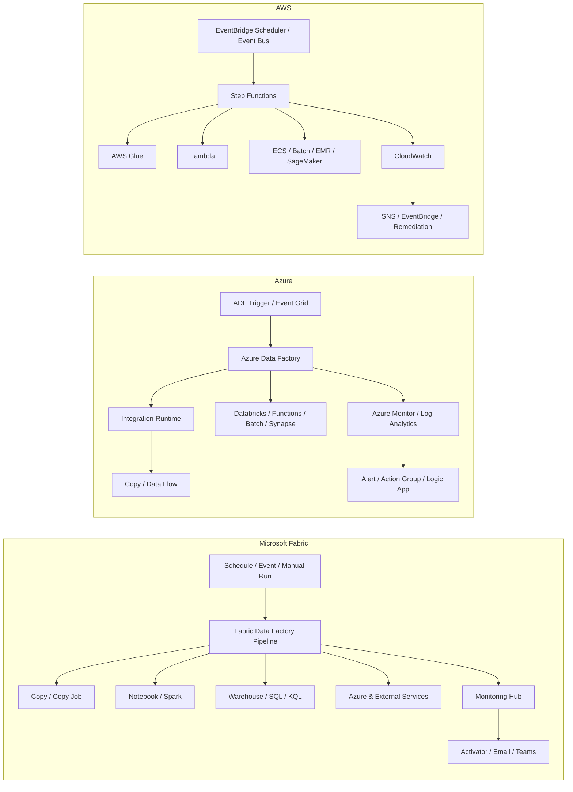
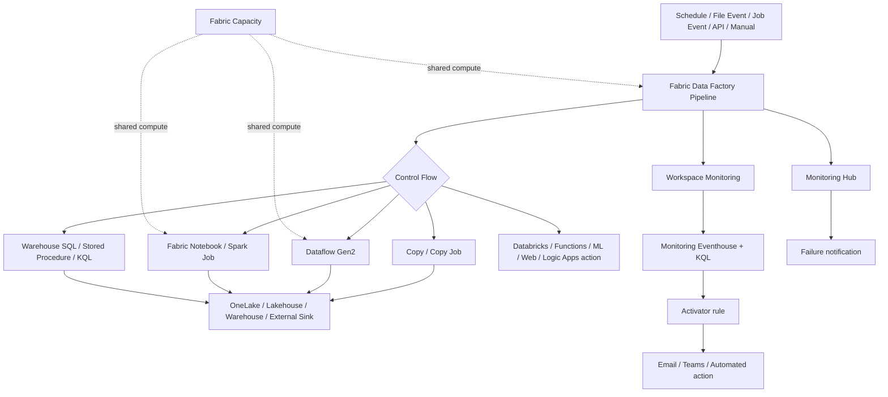
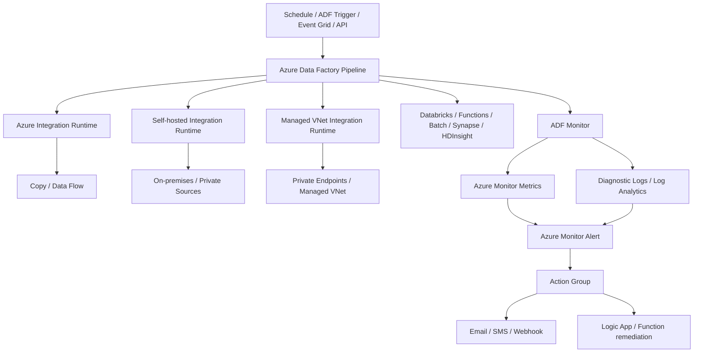
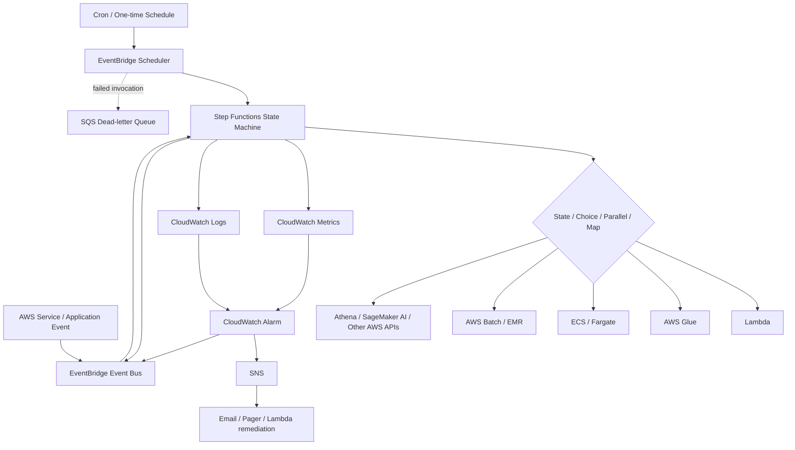
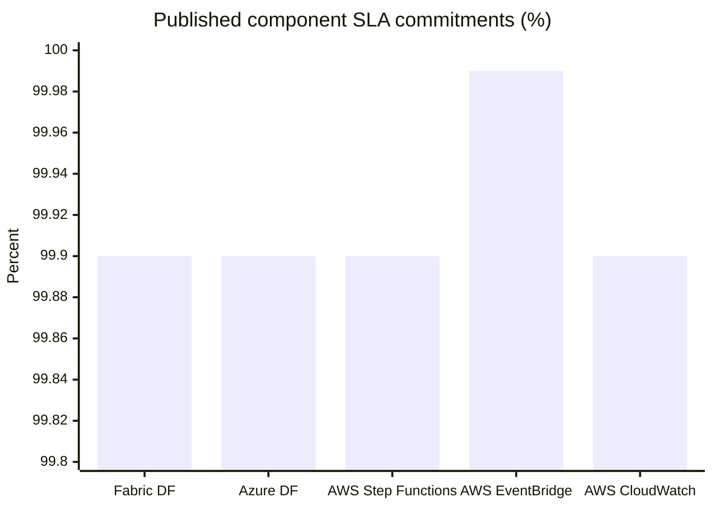
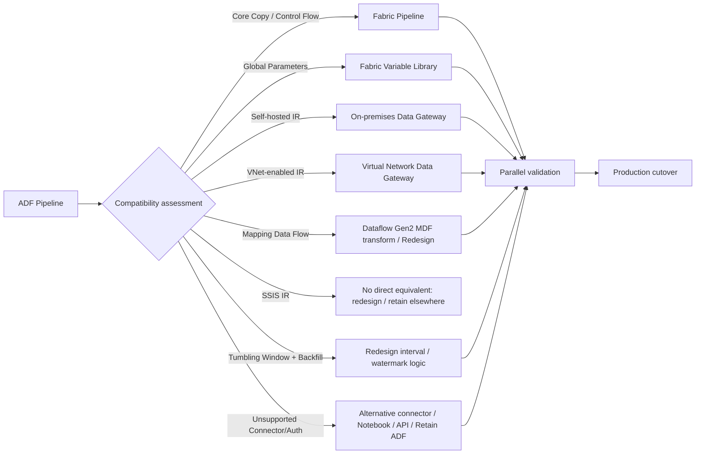

# Orchestration, Scheduling, Monitoring, and Alerting in Microsoft Fabric: Cross-Comparison with Azure and AWS

## Executive summary

As of **November 4, 2026**, Microsoft Fabric has evolved from being primarily an integrated analytics environment into a credible end-to-end orchestration platform. Its center of gravity is **Data Factory in Microsoft Fabric**, with pipelines providing control-flow orchestration, the Fabric scheduler and event triggers providing time- and event-driven execution, the Monitoring hub and Workspace Monitoring providing operational visibility, and **Activator** providing richer event-based alerting and automated responses. Fabric's distinctive advantage is not that its workflow engine is more general-purpose than every Azure or AWS alternative; it is that orchestration, Spark/notebooks, data movement, lakehouse/warehouse workloads, governance, capacity management, and BI all exist inside one SaaS control plane and share Fabric capacity, identity, workspaces, and OneLake. citeturn258917search0turn258917search1turn258917search5turn511538search1

iturn629675image0

For a predominantly **Microsoft data estate**, Fabric is therefore the strongest default when orchestration is tightly coupled to Lakehouse, Warehouse, Dataflow Gen2, Fabric notebooks/Spark, KQL, Power BI, or other Fabric items. Fabric pipelines can also invoke Azure Databricks, Azure Functions, Azure Machine Learning, Azure Batch, external SQL systems, web endpoints, and enterprise actions exposed through Logic Apps connectors. Microsoft documents a 10,000 concurrent-pipeline-run limit per Fabric workspace, up to 120 activities per pipeline, up to 20 schedules per pipeline, and up to 50-way `ForEach` parallelism. citeturn258917search3turn288356search3turn120621search2

**Azure Data Factory (ADF)** remains the more mature Microsoft choice when the orchestration boundary is an Azure subscription rather than a Fabric workspace, especially where existing Integration Runtimes, self-hosted/hybrid networking, mature trigger patterns, Azure-native resource control, or legacy ADF assets matter. A practical Azure architecture normally combines **Azure Data Factory** for data pipelines, **Event Grid** or native ADF triggers for events, **Azure Monitor / Log Analytics** for telemetry and alerting, and optionally **Logic Apps or Azure Functions** for business-process integration and remediation. ADF and Fabric both publish a 99.9% service commitment for Data Factory operations and for starting eligible activity runs within four minutes of their scheduled time. citeturn531805search0turn531805search2turn965552search3turn511538search3

For AWS, the closest functional comparison is not one product but a composition: **AWS Step Functions** as the durable workflow/state-machine engine, **Amazon EventBridge Scheduler/EventBridge** for schedules and events, workload engines such as **AWS Glue, Lambda, ECS/Fargate, Batch, EMR, Athena, or SageMaker AI**, and **Amazon CloudWatch plus SNS/EventBridge** for observability and notification. Step Functions is substantially more general-purpose than Fabric Data Factory: it directly integrates with more than two hundred AWS services through SDK integrations and supports request-response, durable job synchronization, and callback-token patterns. Standard workflows can run for up to one year; Express workflows trade durability/history semantics for very high-throughput executions capped at five minutes. citeturn120621search0turn120621search1turn202487search3

The main architectural distinction is therefore **integration versus composability**. Fabric minimizes platform seams but binds orchestration economics and performance to a shared Fabric capacity. Azure offers finer infrastructure and networking control but requires more services to create a unified operations experience. AWS has the widest composable event/workflow ecosystem and the strongest explicit state-machine semantics, but operational responsibility is distributed across Step Functions, EventBridge, CloudWatch, workload services, IAM, and often SNS/SQS. This conclusion is an architectural inference from the documented service boundaries rather than a vendor-published ranking. citeturn258917search5turn531805search4turn120621search1turn202487search2

For migration from ADF to Fabric, Microsoft now provides both an ADF-in-Fabric mounting experience and an upgrade path, but migration is **not purely mechanical**. Important gaps still include unsupported or changed event-trigger patterns, incomplete tumbling-window/backfill semantics, some authentication/network configurations, SSIS Integration Runtime, some long-tail connectors, and certain Mapping Data Flow capabilities. Microsoft explicitly recommends workload inventory, compatibility testing, side-by-side validation, and phased migration with rollback. citeturn288356search0turn288356search1turn288356search2

## Scope and service mapping

The comparison below deliberately treats each platform as an **operational stack**, not merely a workflow designer. This matters because scheduling, runtime orchestration, telemetry, alerts, identity, retries, fault recovery, and cost accounting often live in different services.

| Dimension | Microsoft Fabric | Azure equivalent stack | AWS equivalent stack |
|---|---|---|---|
| Primary orchestrator | Fabric Data Factory Pipelines | Azure Data Factory Pipelines | AWS Step Functions |
| Primary scheduler | Fabric pipeline scheduler / Job Scheduler | ADF schedule & tumbling-window triggers; optionally Logic Apps | Amazon EventBridge Scheduler |
| Event initiation | Fabric events, job/workspace events, Eventstreams/Activator | ADF event triggers + Event Grid | Amazon EventBridge / EventBridge Scheduler |
| Data integration | Copy activity / Copy Job / Dataflow Gen2 | ADF Copy / Mapping Data Flow | AWS Glue, DataSync, DMS, Lambda, EMR depending use case |
| Code/data compute | Fabric Notebook, Spark Job, Warehouse SQL, KQL; external Databricks etc. | Databricks, HDInsight, Functions, Synapse, Batch, external compute | Lambda, Glue, ECS/Fargate, Batch, EMR, EKS, SageMaker AI, Athena |
| Monitoring | Monitoring hub; Workspace Monitoring/Eventhouse/KQL; Capacity Metrics | ADF Monitor + Azure Monitor + Log Analytics | Step Functions console + CloudWatch metrics/logs |
| Alerting | Free scheduled-job failure email; Activator-based alerts; Teams/Outlook activities | Azure Monitor alerts/action groups; Logic Apps | CloudWatch Alarms + SNS/EventBridge/Lambda |
| Identity | Microsoft Entra ID; workspace identity; workspace roles | Entra ID, Azure RBAC, managed identities | IAM roles/policies, IAM Identity Center |
| Private networking | Fabric Private Link, managed private endpoints, VNet/on-premises gateways | Private Link, Managed VNet, private endpoints, self-hosted IR | VPC endpoints/PrivateLink where supported, IAM and service networking |
| Billing center | Shared Fabric Capacity Units plus storage/related meters | Activity runs, IR execution, data movement, Azure Monitor etc. | Step Functions transitions or request-duration + each component's usage |
| Best fit | Unified Microsoft analytics/data estate | Azure-centric hybrid/data integration | General serverless/event-driven orchestration across AWS |

Fabric's workload surface is broader than a traditional ETL scheduler: its activities include Copy, Dataflow, Fabric notebooks, Spark jobs, SQL scripts, stored procedures, KQL, Azure Databricks, Azure Functions, Azure ML, Azure Batch, approvals, REST/webhook calls, Teams messaging, and calls to other Fabric pipelines or APIs. Fabric connectors also cover Azure, on-premises, SaaS, and several AWS and third-party stores, although capability differs by connector and by whether it is used from Dataflow Gen2, Copy Activity, or Copy Job. citeturn288356search3turn288356search4turn120621search23

ADF has a similar pipeline/activity abstraction but keeps execution infrastructure conceptually separate through Integration Runtimes. It can orchestrate built-in data movement plus Azure Functions, Databricks notebooks/JAR/Python workloads, HDInsight, Azure Batch custom activities, Synapse notebooks, stored procedures, and other compute. Microsoft now describes Fabric Data Factory as the successor direction while continuing to document ADF as a mature Azure service. citeturn120621search4turn120621search7turn511538search2

Step Functions instead represents orchestration explicitly as an **Amazon States Language state machine** and delegates compute to other services. Optimized integrations include Lambda, Glue, Batch, ECS/Fargate, EKS, EMR, Athena, SageMaker AI, SNS, SQS, EventBridge and others, while AWS SDK integration exposes APIs from more than two hundred AWS services. That makes it particularly effective for mixed application/data/control-plane workflows rather than ETL alone. citeturn120621search0turn120621search10turn120621search24

A useful conceptual entity map is:

The mapping above follows each vendor's documented orchestration and monitoring relationships; it should not be read as implying one-to-one implementation equivalence. citeturn258917search0turn258917search1turn531805search0turn202487search0turn202487search1turn202487search2

## Architectures and orchestration flows

### Microsoft Fabric architecture

A representative Fabric production flow starts with a fixed or interval schedule, an event, an API/manual start, or another Fabric item. The pipeline then coordinates data movement and transformation activities. Execution metadata can be inspected in Monitoring hub; Workspace Monitoring can persist execution telemetry in an Eventhouse/KQL database; failures or other job-state events can feed free failure notifications or paid Activator rules for richer responses. citeturn258917search0turn258917search1turn258917search2turn258917search8

The significant design property is **shared capacity**. Pipeline orchestration and data movement consume Fabric meters inside the same capacity model used by other Fabric experiences. The Capacity Metrics app exposes consumption and helps identify peak demand and expensive items. Capacity can be resized, and Microsoft publishes F2 through F8192 SKUs with corresponding Capacity Units. citeturn258917search5turn258917search6

Scheduling supports on-demand, fixed schedule, multiple schedules, and event-driven runs. A pipeline can currently have up to 20 schedules. Interval-based scheduling exists but remains preview in the documentation retrieved for this report; unlike mature ADF tumbling-window behavior, time-slice backfill is not yet fully implemented. Scheduled-run failure email is built in, whereas richer Started/Succeeded/Failed event logic can use Activator. citeturn258917search0turn258917search3turn258917search4

Fault handling exists at several levels. Activities support retries and retry intervals, branches can implement explicit failure paths, and pipeline runs can be inspected or rerun. Microsoft recommends monitoring capacity as well as job status because Fabric throttling and workload contention can arise from shared CU consumption rather than only from a single pipeline's concurrency settings. citeturn288356search3turn258917search6

### Azure architecture

For an Azure-native data platform, the closest functional composition uses **Azure Data Factory + Azure Monitor**, with **Event Grid** or ADF trigger mechanisms at the ingress edge and optionally **Logic Apps/Azure Functions** for remediation or cross-application actions.

ADF separates the orchestration/control plane from the **Integration Runtime**, which can be Azure-hosted, self-hosted, or deployed with managed-VNet isolation. This model remains valuable for hybrid integration because self-hosted IR can execute against private/on-premises resources while Azure-hosted IR handles cloud data movement and pipeline activities. Managed VNets and managed private endpoints can isolate integration traffic and reduce exposure to the public internet. citeturn531805search4turn511538search3turn511538search4

ADF monitoring exposes pipeline, trigger, and activity status, while Azure Monitor adds metrics, log analytics and alert rules. A useful operational feature is ADF's expected-duration metric: teams can define the expected pipeline run duration, allowing Azure Monitor to alert when the run exceeds the business threshold rather than waiting for an eventual failure. citeturn531805search0turn531805search1

ADF also has internal recovery mechanisms for some transient orchestration problems and allows activity/pipeline reruns; however, production designs should treat retry behavior as application semantics rather than assuming every failure is safe to replay. Idempotent sinks and deterministic partition/watermark logic remain important, particularly for copy/ELT processes. citeturn531805search6

### AWS architecture

AWS generally decomposes the same requirements into specialized services. The following architecture uses **EventBridge Scheduler**, **Step Functions**, workload-specific compute, **CloudWatch**, and **SNS/EventBridge**.

EventBridge Scheduler provides cron/rate/one-time schedules, configurable retry behavior, a maximum failed-invocation event age, and SQS dead-letter queues. AWS documentation gives a maximum event age of 24 hours and up to 185 Scheduler retries. Standard Step Functions workflows also publish execution-status events automatically to EventBridge, whereas Express workflow monitoring relies on CloudWatch Logs rather than the same Standard-workflow status-event mechanism. citeturn202487search0turn202487search1

Step Functions' fault model is especially explicit: states can define retries, catches, timeouts and callback heartbeats; Standard workflows durably preserve execution state. AWS recommends explicit task timeouts, heartbeats for callback tasks, designing for idempotency and duplicate delivery, and avoiding orchestration embedded inside chains of Lambda functions when a state machine better expresses the workflow. citeturn288356search7turn288356search8

Its scalability model differs materially from Data Factory. Step Functions permits up to **1,000,000 open Standard workflow executions per account per Region** by default, while Express does not have that open-execution quota. Distributed Map supports up to 10,000 parallel child executions within a Map Run. Standard workflow state transitions are subject to region-specific token-bucket quotas—for example, 5,000 transitions per second in several major regions—whereas Express state transitions are documented as unlimited at that quota layer. citeturn202487search3

## Capability, reliability, security, and operational comparison

The following table summarizes the most material differences. "Strong," "moderate," and similar descriptions are analytical judgments based on the documented features, not vendor ratings.

| Dimension | Microsoft Fabric | Azure stack | AWS stack |
|---|---|---|---|
| Data-pipeline orchestration | **Strong**; first-class | **Strong / mature** | Strong when Step Functions is combined with Glue/EMR/etc. |
| General application workflow | Moderate; possible through web/functions/business actions | Strong with Logic Apps + Functions | **Very strong** with Step Functions |
| Schedule semantics | Fixed + multiple schedules; interval schedule still evolving | Mature schedule/tumbling-window patterns | Very strong EventBridge Scheduler |
| Event-driven execution | Strong and rapidly expanding | Mature Event Grid + ADF patterns | **Very strong** EventBridge ecosystem |
| Human approval | Native pipeline approval activity | Usually Logic Apps/custom pattern | Callback/task-token or custom application pattern |
| Long-running durable workflow | Data-pipeline oriented | Data-pipeline oriented | **Standard workflow up to one year** |
| High-volume short workflow | Capacity-dependent | ADF scale limits / other Azure services | **Express workflow specifically designed for this** |
| Hybrid/on-prem integration | OPDG/VNet gateway | **Very mature SHIR/IR model** | Agent/service-specific; no exact Step Functions IR analogue |
| Centralized data-platform monitoring | **Strongest integration** inside Fabric | Powerful but distributed across ADF/Monitor | Powerful but distributed across CloudWatch/services |
| Rich alerting | Activator; some capabilities remain preview | **Mature Azure Monitor alerts/action groups** | **Mature CloudWatch + SNS/EventBridge** |
| Shared platform governance | Strong workspace/OneLake/Purview model | Azure RBAC/Policy/Purview across services | IAM/Organizations/CloudTrail/Lake Formation depending workload |
| Private networking | Strong but SaaS/Fabric-specific | **Fine-grained Azure networking** | Strong VPC/IAM endpoint patterns |
| Cost isolation | Capacity-level attribution | Per-service/resource metering | Fine-grained service-level metering |
| Multicloud connectors | Good data connectors | Good data connectors | AWS-centric APIs; cross-cloud via HTTP/partners/custom integrations |
| Workflow-as-code portability | JSON/source-control capabilities | ARM/Bicep/JSON/Git patterns | **ASL + IaC widely used** |
| ETL-to-BI integration | **Exceptional** because OneLake/Fabric/Power BI are one platform | Strong but multi-service | Requires assembly of analytics/BI services |

Fabric authenticates through Microsoft Entra ID and supports workspace roles, workspace identities, Conditional Access, Private Link, managed private endpoints, service tags, VNet/on-premises gateways, sensitivity labels and integration with Azure Key Vault. Microsoft specifically recommends least privilege, separate workspaces for security boundaries, audit logging, Git integration, and secure secret management rather than embedding credentials in pipelines. citeturn511538search0turn511538search1

ADF similarly supports Azure RBAC, system-assigned and user-assigned managed identities, Key Vault references, Private Link, managed VNets and private endpoints. An important governance consideration is that principals allowed to create/run pipelines with a Data Factory identity can indirectly exercise the permissions already granted to that identity, so the identity's downstream roles must be minimized and audited. citeturn511538search2turn511538search3

Step Functions relies on IAM identities and execution roles. AWS recommends federation and temporary credentials rather than long-lived IAM-user credentials. Step Functions encrypts data at rest with AWS-owned keys by default and can use customer-managed KMS keys for state-machine definitions, execution history and activity inputs. Network access can also be restricted using VPC endpoint conditions. citeturn511538search5turn511538search6turn511538search7

For observability, Fabric's emerging advantage is **correlation inside the analytics platform**. Monitoring hub can aggregate job runs and alerts, while Workspace Monitoring stores platform logs in a monitoring Eventhouse that can be queried with KQL and subsequently used by Activator rules. However, several of these new monitoring/alerting capabilities remain marked preview in current documentation, which is an important production-readiness caveat. citeturn258917search7turn258917search8turn258917search4

Azure Monitor is more established as a cross-resource observability plane: ADF metrics/logs can participate in the same alerting system as the rest of Azure, and Logic Apps or Functions can be invoked for remediation. AWS CloudWatch offers equivalent cross-service metrics, logs, dashboards and alarms; Step Functions metrics can alert on failed state machines, throttling and execution states. CloudWatch metric delivery for Step Functions is documented as best-effort, so durable audit or workflow-state requirements should rely on execution histories/logging rather than treating a metric stream as a transactional ledger. citeturn531805search0turn531805search7turn202487search2turn951812search28

Operationally, the most robust pattern across all three environments is to make workflow steps **idempotent**, distinguish transient from permanent failures, bound retries, apply explicit timeouts, externalize durable business state from ephemeral compute, instrument latency and backlog rather than only failure counts, and use dead-letter or quarantine paths for unrecoverable inputs. AWS explicitly frames failure/duplicate tolerance as a serverless design principle, while Microsoft recommends nonfunctional SLAs, throughput targets and observability validation during ADF-to-Fabric upgrades. citeturn288356search8turn288356search0

## Scalability, SLA, limits, and cost model

Published service-level commitments are not directly equivalent to end-to-end workflow availability because an orchestration solution also depends on downstream compute, storage, networking and notification services. At the orchestration-service layer, however, the following commitments are published: Fabric Data Factory pipelines 99.9%, ADF 99.9%, AWS Step Functions 99.9%, and EventBridge 99.99%; CloudWatch's covered functions have a 99.9% commitment. Fabric and ADF additionally state that eligible activity runs should begin within four minutes of scheduled time at least 99.9% of the time. citeturn965552search3turn531805search2turn511538search8turn965552search1turn965552search2

The chart is deliberately component-level. No authoritative source identified in this research publishes a single comparable **end-to-end workflow SLA** for the complete Fabric, Azure, or AWS stacks; multiplying component SLAs would also be misleading where dependencies are parallel, optional, retried, or have different availability definitions. citeturn965552search3turn511538search8turn965552search1

Published limits provide another useful—but imperfect—numeric comparison:

| Metric | Fabric Data Factory | Azure Data Factory | AWS Step Functions |
|---|---:|---:|---:|
| Concurrent/open workflow executions | 10,000 concurrent pipeline runs/workspace | 10,000 concurrent pipeline runs/factory | 1,000,000 open Standard executions/account/Region |
| Workflow definitions | 1,000 pipelines/workspace | 5,000 total factory entities across multiple entity types | 100,000 state machines default |
| Steps/activities | 120 activities/pipeline | No directly comparable value used here | Definition limited by 1-MB state-machine document, not an equivalent activity count |
| Fan-out | ForEach max parallelism 50 | Depends on pipeline/activity quotas | Distributed Map: up to 10,000 parallel child executions |
| Longest workflow | Documentation contains activity-specific limits; not directly comparable | Workload/activity dependent | Standard: 1 year; Express: 5 minutes |
| Execution-history retention | Fabric monitoring dependent | Monitoring/log-retention configuration dependent | Standard closed execution history: 90 days by default |
| Directly comparable scheduling latency SLA | ≤4 min at 99.9% | ≤4 min at 99.9% | No equivalent Scheduler-start latency commitment identified |

The first row should **not** be used to conclude that Step Functions is "100× more scalable": "open executions" and "concurrent pipeline runs" are different workload units, and the execution engines have different throttling dimensions. The valid conclusion is that AWS exposes a high-scale state-machine model while Fabric/ADF publish large but pipeline-centric concurrency limits. citeturn258917search3turn531805search3turn202487search3

Fabric's cost model is capacity-centric. Data Factory pipeline consumption contributes to Fabric Capacity Unit use through orchestration and data-movement meters, Dataflow Gen2 uses compute meters, and OneLake storage is metered separately. This simplifies procurement and can be attractive when the same capacity serves Warehouse, Lakehouse, Power BI, Spark and orchestration; the tradeoff is **contention and less direct per-workflow cost isolation**. Microsoft recommends using the Capacity Metrics app and capacity-sizing process rather than sizing solely from pipeline counts. citeturn258917search5turn258917search6

ADF is closer to a granular consumption model. Microsoft charges pipeline orchestration by activity/trigger/debug runs, data movement by Integration Runtime consumption, and other pipeline/external activities according to runtime usage; network transfer and downstream services can add separate charges. Azure Monitor additionally meters log ingestion/retention, queries and some alert capabilities. Logic Apps Consumption uses trigger/action consumption while Standard has its own hosting model. citeturn531805search4turn951812search16turn951812search0

AWS Step Functions Standard charges by **state transitions**, including retry transitions, while Express charges by number of workflow requests and execution duration/memory. EventBridge, Glue/Lambda/ECS/Batch, CloudWatch Logs/metrics/alarms, SNS, data transfer and storage have independent meters. This architecture yields excellent cost attribution but can create a "many small meters" FinOps problem unless tags, CUR/cost-allocation reports and workload-level telemetry are standardized. The last observation is an inference from the independent pricing models rather than an AWS-stated limitation. citeturn202487search4turn951812search2turn951812search4

Because exact prices vary by region, contract, capacity SKU and workload shape, assigning a dollar winner without a region and workload trace would not be rigorous. In general, Fabric tends to be economically attractive when otherwise-idle shared capacity already exists; Step Functions is attractive for sparse or elastic orchestration because the orchestration engine is granularly metered; and ADF provides predictable consumption accounting for data-integration-centric workloads. These are cost-structure inferences, not universal price rankings. citeturn258917search5turn531805search4turn202487search4

## Limitations and operational best practices

Fabric's principal limitations are maturity gaps rather than lack of basic orchestration capability. Interval scheduling does not yet reproduce every ADF tumbling-window/backfill behavior; some ADF trigger chains and custom event triggers cannot be upgraded directly; some connectors and authentication/network patterns remain unsupported; SSIS Integration Runtime has no direct Fabric equivalent; and some Mapping Data Flow upgrade capabilities remain preview. Monitoring hub and advanced job alerting are also currently documented as preview, and Activator alerts require Workspace Monitoring availability in the region. citeturn258917search3turn258917search4turn288356search2

ADF's main architectural limitation relative to Fabric is fragmentation rather than capability. ADF, Monitor/Log Analytics, Key Vault, networking, compute targets and Logic Apps are separate Azure resources with independent RBAC and billing. This allows strong isolation and infrastructure control but increases operational surface area. Conversely, mature Integration Runtime and private-network patterns make ADF preferable for some enterprise hybrid estates that cannot yet map cleanly to Fabric gateway models. citeturn511538search3turn511538search4turn288356search0

Step Functions' constraints depend strongly on workflow type. Standard workflow execution history has a 25,000-event limit and state-transition throttles; Express workflows are limited to five minutes and do not provide the same durable execution-history/redrive model. Large payloads should be externalized—for example to S3—and tasks should have explicit timeouts. AWS also warns that `.sync` jobs can continue consuming downstream resources if cancellation does not propagate successfully. citeturn202487search3turn288356search7turn120621search1

For Fabric operations, a sound production baseline is to separate development/test/production workspaces, use Git/deployment controls, parameterize environment differences through variable libraries, configure retries only for demonstrably transient faults, set secure input/output on activities carrying secrets, enable Workspace Monitoring where available, query run telemetry centrally rather than relying on individual pipeline pages, and monitor CU utilization alongside run failures. For critical jobs, advanced alerting should go beyond "failed" to include overdue, unexpectedly long, missing, or unusually high-volume runs. The first group follows Microsoft guidance and available controls; the overdue/missing-run recommendation is an operational inference. citeturn288356search3turn511538search0turn258917search1turn258917search6

For Azure, define pipeline expected-duration thresholds, forward diagnostics to Log Analytics, use Azure Monitor action groups for centralized routing, apply managed identities instead of credentials, keep data movement private through managed VNets/private endpoints where required, and build idempotent rerun semantics. For hybrid deployments, treat self-hosted IR as production infrastructure: monitor health, capacity and network dependencies rather than assuming the managed ADF control plane makes the entire path serverless. citeturn531805search1turn511538search2turn511538search3

For AWS, use Standard workflows when executions require durable state, long waits, callbacks or auditability, and use Express primarily for high-rate short-lived workflows where its five-minute model is appropriate. Configure `Retry`/`Catch`, `TimeoutSeconds`, callback heartbeats, EventBridge Scheduler DLQs, CloudWatch alarms on failures and throttling, and SNS/EventBridge-driven incident/remediation paths. AWS's Well-Architected guidance explicitly recommends state machines instead of function-to-function orchestration and designing event-driven consumers for failures and duplicate delivery. citeturn288356search7turn288356search8turn202487search0

## Migration considerations and conclusions

The lowest-risk migration path from **ADF to Fabric** starts with inventory rather than code conversion. Categorize pipelines by trigger type, connector, Integration Runtime, data-flow use, identity pattern, private-network dependency, global parameters, activity types, retry semantics and operational SLA. Microsoft specifically recommends deciding which components should be reused, translated or redesigned and validating authentication, networking, scheduling, observability, throughput and cost before production cutover. citeturn288356search0turn288356search5

The mapping is conceptually straightforward but not always syntactically identical:

Microsoft's current guidance maps ADF self-hosted Integration Runtimes to the On-premises Data Gateway, VNet-enabled IRs to Virtual Network Data Gateways, and global parameters to Fabric Variable Libraries. It also explicitly states that SSIS IR is unavailable in Fabric and identifies trigger, connector, identity and Mapping Data Flow cases that require redesign. citeturn288356search0turn288356search2

Organizations already invested heavily in ADF do not need an immediate all-or-nothing cutover. Microsoft's "bring Azure Data Factory to Fabric" capability allows factories to be surfaced in Fabric before full upgrade, enabling side-by-side evaluation. That makes a staged strategy practical: first centralize visibility and new development around Fabric, migrate compatible pipelines, and retain ADF temporarily for the edge cases whose networking, trigger or transformation requirements are not yet equivalent. citeturn288356search1turn288356search6

Migration between Microsoft and AWS requires more redesign because the orchestration abstractions differ. An ADF/Fabric pipeline's activity graph most naturally becomes a Step Functions state machine, Copy/Dataflow work may map to Glue or other data services, schedules to EventBridge Scheduler, monitoring to CloudWatch, and notification/action groups to SNS/EventBridge/Lambda. However, parameters, retry semantics, callback behavior, identities, connector configuration, deployment artifacts and cost units are not portable one-for-one. This mapping is an architectural inference based on the vendors' documented service models. citeturn120621search1turn202487search0turn202487search2turn202487search5

Conversely, migrating AWS Step Functions applications into Fabric should not assume that every state-machine workflow belongs in Data Factory. Data-centric flows involving ingestion, transformation, notebooks, Warehouse/Lakehouse operations and BI are strong Fabric candidates. Complex application choreography involving callbacks, year-long waits, very large numbers of independent short-lived executions, or broad AWS API orchestration may require Azure Logic Apps/Durable Functions or continued Step Functions rather than a forced translation into a data pipeline. This is an architectural recommendation derived from the documented workflow capabilities. citeturn120621search0turn202487search3turn531805search7

The decision can therefore be reduced to architectural intent. **Choose Fabric as the orchestration center when the workflow's state and value are primarily inside the Fabric analytics estate; choose ADF when Azure data integration, hybrid networking and mature ADF semantics dominate; choose Step Functions/EventBridge when the workflow is a general distributed application or event-driven AWS control plane.** Mixed enterprises can—and often should—use more than one: Fabric for analytics pipelines, Azure or AWS workflow services for application/process orchestration, and event/API boundaries between them. That hybrid recommendation follows from the different strengths and service boundaries documented above rather than from a requirement to standardize on one cloud scheduler. citeturn120621search11turn288356search0turn120621search22